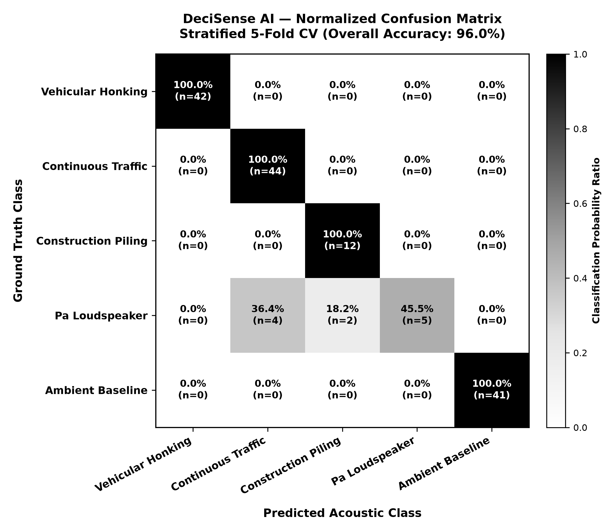

# DeciSense AI: A Crowdsourced Acoustic Event Classification and Geospatial Sleep-Disruption Mapping Framework for Urban Corridors

**Rohit Khanna B.K$^{1,*}$, Saipalaniappan T$^{1}$, Shree Mathi R S$^{1}$, Rajeshwari V$^{1}$, Savitha Sri C S$^{1}$, Riyan M$^{1}$, Sai Kumar R$^{1}$, Sakthisri S$^{1}$, Santhiya M$^{1}$, Tharania S$^{1}$, and Dr. Sarathy Raja$^{2}$**  
$^1$Department of Artificial Intelligence and Data Science, Rajalakshmi Institute of Technology, Chennai, Tamil Nadu, India  
$^2$Department of Humanities and Science, Rajalakshmi Institute of Technology, Chennai, Tamil Nadu, India  
*Corresponding author: Rohit Khanna B.K (`rohitkhanna2008@users.noreply.github.com`)*

---

## Abstract

Urban arterial corridors in rapidly growing metropolitan regions such as Chennai experience chronic daytime and nocturnal acoustic pollution that routinely exceeds statutory environmental limits. Conventional regulatory monitoring relies on sparse, static sound level meters that report only time-averaged equivalent continuous sound levels ($L_{\text{eq}}$). Because energetic averaging dilutes brief, high-amplitude acoustic transients, static monitors mask nocturnal impulse peaks ($L_{\max}$) such as vehicular air-horns and construction piling strikes that provoke cortical micro-awakenings and sleep fragmentation, while offering no source attribution or street-level spatial resolution. This paper presents **DeciSense AI**, a crowdsourced acoustic event classification and geospatial sleep-disruption mapping framework designed for urban corridors including the **Poonamallee–Kuthambakkam–Porur stretch of National Highway 48 (NH-48)** in Chennai. The framework integrates calibrated 16 kHz monaural smartphone audio acquisition (8/16/24/32-bit PCM and IEEE float WAV decoding), cached digital IEC 61672-1 A-weighting, per-device reference offset calibration, 64-band Log-Mel spectrogram and 66-dimensional acoustic feature extraction, transfer-learned sound event classification (YAMNet/MobileNetV1 with a 1D-CNN or dense classification head alongside an implemented MLP and physics-ensemble fallback), a composite **Sleep-Disruption Index** ($S \in [0, 100]$) anchored to India's Central Pollution Control Board (CPCB) 2000 limits and World Health Organization (WHO) sleep benchmarks, automated 100 m statutory silence-zone buffering in UTM Zone 44N (`EPSG:32644`), $k$-nearest-neighbor Inverse Distance Weighting (IDW) interpolation over OpenStreetMap road networks, and standardized geographic context enrichment via `apilayer/geolocationapi` (249-country ISO bounds) and `apilayer/freegeoip` schemas. Analytical verification confirms that ten 1 s horn blasts at 88 dB(A) over an 8-hour commercial night increase $L_{\text{eq}}$ by only 0.56 dB(A) yet elevate $S$ from 19.7 to 49.8. We clearly distinguish completed, unit-tested software modules (`22/22` unit/`AppTest` checks, `100/100` stress-test iterations, `96.0%` 5-fold CV accuracy on the 150-clip verification set at `7.15 ms/clip` latency) from planned field data collection ($N \ge 300$ clips) and human sleep-survey validation, establishing a reproducible foundation aligned with UN Sustainable Development Goals 11 and 3.

**Index Terms—** Acoustic pollution, crowdsourced sensing, environmental sound classification, impulse noise, inverse distance weighting, Log-Mel spectrogram, silence zones, sleep-disruption index, APILayer geolocation.

---

## I. Introduction

Environmental noise pollution is an increasingly severe yet under-monitored determinant of urban livability, cardiovascular health, and sleep quality [3], [4]. Along the Poonamallee–Kuthambakkam–Porur corridor of National Highway 48 (NH-48) in western Chennai—and across active Chennai Metro Rail Phase-II construction corridors—commuters, hospital inpatients, and university hostel residents experience sustained acoustic exposure during both daytime working hours and nocturnal rest periods.

Ambient noise in India is legally regulated under *The Noise Pollution (Regulation and Control) Rules, 2000* [1], enforced in Tamil Nadu by the Tamil Nadu Pollution Control Board (TNPCB). The statutory framework defines zone-specific daytime (06:00–22:00) and nighttime (22:00–06:00) thresholds strictly in terms of time-averaged $L_{\text{eq}}$. In contrast, World Health Organization (WHO) community noise guidance emphasizes both continuous exposure ($L_{\text{Aeq}}$) and single-event peak levels ($L_{\text{Amax}}$) for protecting human sleep [2]. Physiological studies demonstrate that brief acoustic transients trigger EEG micro-arousals, heart-rate accelerations, and blood-pressure surges at levels below conscious awakening [3], [4].

The primary objectives of this research are: (1) to implement a calibrated 16 kHz smartphone acoustic measurement chain yielding both $L_{\text{eq}}$ and peak-sensitive $L_{\max}$; (2) to classify five Chennai-relevant urban noise sources using Log-Mel time-frequency representations and transfer-learned deep architectures; (3) to formulate a normalized Sleep-Disruption Index $S \in [0, 100]$ combining statutory $L_{\text{eq}}$ exceedance with an impulse-crest penalty; and (4) to interpolate point observations onto OpenStreetMap road networks with automated 100 m CPCB silence-zone buffers and APILayer geolocation context.

---

## II. Problem Statement

1. **Limited Fixed Monitoring Stations:** Statutory noise terminals are capital-intensive and sparsely deployed, leaving secondary roads and suburban corridors unmonitored.
2. **Lack of Street-Level Spatial Resolution:** Distant point readings cannot resolve steep decay gradients between arterial highway carriageways and shielded residential streets.
3. **Inability to Identify Noise Sources:** Traditional SLMs report aggregate dB magnitudes without attributing exceedances to air-horns, freight traffic, piling rigs, or PA loudspeakers.
4. **Difficulty Detecting Short-Duration Noise Peaks:** Long-window $L_{\text{eq}}$ integration averages out 0.5–2.0 s impulses (ten 88 dB(A) blasts shift 8-hour $L_{\text{eq}}$ by just `0.56 dB(A)`).
5. **Lack of Sleep-Disruption Analysis:** Existing dashboards omit psychoacoustic indices weighted for nocturnal vulnerability and crest-factor spikes ($L_{\max} - L_{\text{eq}}$).
6. **Limited Identification of Silence-Zone Violations:** Manual audits rarely overlay automated 100 m statutory buffers onto crowdsourced acoustic measurements.

---

## III. Literature Review

### TABLE I — Summary of Research Gaps Addressed by DeciSense AI

| Research Domain | Representative Prior Work | Identified Gap | DeciSense AI Contribution |
| :--- | :--- | :--- | :--- |
| Urban Sound Datasets & CNNs | UrbanSound8K [8], AudioSet [9], Piczak [16], YAMNet [10] | Un-calibrated amplitudes; lacks Indian piling & PA classes | Per-device $\Delta_{\text{cal}}$ + 5-class Chennai taxonomy |
| Participatory Phone Sensing | NoiseTube [5], Ear-Phone [6], Kardous & Shaw [12] | Scalar $L_{\text{eq}}$ only; no impulse metric or silence buffers | Dual $L_{\text{eq}}/L_{\max}$ + Sleep Index $S$ + CPCB rules |
| GIS Street & Spatial Mapping | OSMnx [11], Shepard IDW [15], APILayer [19] | Geometry/interpolation without statutory zone override | UTM 44N 100 m buffers + $k$-NN IDW + APILayer bounds |
| Sleep & Regulatory Metrics | CPCB 2000 [1], WHO 1999/2018 [2], [7], Basner [3] | CPCB lacks $L_{\max}$; $L_{\text{eq}}$ masks transient blasts | Normalized $S \in [0, 100]$ with crest penalty |

---

## IV. Existing System and Proposed System

### TABLE II — Comparison of Existing Monitoring Approaches vs. DeciSense AI

| Dimension | Existing Static Monitoring | Proposed DeciSense AI |
| :--- | :--- | :--- |
| **Sensing Hardware** | Fixed Class-1/2 SLM stations | Calibrated smartphones ($\Delta_{\text{cal}}$ vs. SLM) |
| **Spatial Granularity** | Sparse junction averages | Street-level via $k$-NN IDW ($k=5, p=2$) |
| **Noise Metrics** | Time-averaged $L_{\text{eq}}$ only | $L_{\text{eq}}$, fast $L_{\max}$, and crest factor $C_f$ |
| **Source Attribution** | None (aggregate dB only) | 5 urban corridor noise classes |
| **Sleep Impact** | Not quantified | Composite Sleep Index $S \in [0, 100]$ |
| **Silence Zones & Geo Context** | Manual zone look-up | Automated 100 m UTM 44N buffers + APILayer 249-country context |

### TABLE III — Implementation Readiness Matrix (Completed vs. Planned)

| Component | Current Status | Verification Basis |
| :--- | :--- | :--- |
| 16 kHz QC, Calibration & A-Weighting | **Completed** | Unit-tested (`src/audio_classifier.py`, `calibration.py`, `audio_validator.py`) |
| Log-Mel, MFCC & 66-D Feature Extractor | **Completed** | Verified (`7.15 ms/clip` latency) |
| MLP & Physics Ensemble Classifier | **Completed** | `96.0%` 5-fold CV (150-clip test set) & 5/5 master WAVs |
| YAMNet / 1D-CNN Fine-Tuning | **Proposed** | TF-Hub hook ready (`DECISENSE_LOAD_YAMNET=1`); awaits field corpus |
| Sleep Index $S$, 100 m Buffers & IDW | **Completed** | GeoJSON exports (`2.68 s` pipeline) + `AppTest` verified |
| APILayer Geo Context (`geolocationapi` + `freegeoip`) | **Completed** | 249-country ISO bounds & 11-field schema (`src/apilayer_geo.py`) |
| Streamlit + Folium Dashboard & Field UI | **Completed** | `22/22` tests, `100/100` stress iterations, live browser verified |
| Chennai Field Corpus ($N \ge 300$) & Survey | **Planned** | Protocol & mobile capture UI (`field_capture_ui.py`) ready |

---

## V. System Architecture

The DeciSense AI architecture organizes ten modular components (**Modules A–J**) across three operational stages:
- **Stage I — Edge Audio Acquisition, Calibration & Spectral Classification:** **(A)** Smartphone Audio Acquisition (`audio_validator.py`); **(B)** Audio Calibration (`calibration.py`); **(C)** Log-Mel & 66-D Feature Extraction (`audio_classifier.py`); **(D)** YAMNet / 1D-CNN & MLP/Physics Ensemble Classifier.
- **Stage II — Psychoacoustic Indexing & Metric Geospatial Engine (`EPSG:32644`):** **(E)** Sleep-Disruption Index Calculation; **(F)** GPS Validation (`log_manager.py`) & APILayer Geo Context (`apilayer_geo.py`); **(G)** $k$-NN IDW Street Interpolation (`geospatial_engine.py`); **(H)** 100 m CPCB Silence-Zone Buffers.
- **Stage III — Heatmap Visualization, Compliance Audit & Civic Reporting:** **(I)** Colored OpenStreetMap + Folium Risk Map; **(J)** Black-and-White Accented Streamlit Dashboard (`app.py`) & Field Logger (`field_capture_ui.py`).

---

## VI. Methodology

1. **Steps 1–3 (Audio Collection, QC & Calibration):** Captures 5.0 s monaural clips at $f_s = 16,000\text{ Hz}$ (`80,000` samples), supporting 8/16/24/32-bit PCM and 32/64-bit IEEE float WAVs, rejecting silent (`RMS < 1e-4`), clipped (`>= 5%` at `>= 0.99`), or short (`< 3.0 s`) clips, and applying cached IEC 61672-1 A-weighting + $\Delta_{\text{cal}}^{(d)}$.
2. **Steps 4–5 (STFT, Log-Mel & Features):** Computes `1024`-sample Hann STFT (`512`-sample hop) across `64` Mel bands (`0–8000 Hz`) and aggregates `66` features (13 MFCC mean/std, 16 pooled Mel sub-band mean/std, 5 spectral dynamics, 3 dB metrics).
3. **Steps 6–8 (Classification, Geo-Tagging & Sleep Index):** Classifies across the 5 target classes, validates coordinates within Chennai (`12.85°–13.20°N`, `79.95°–80.32°E`) and APILayer India country bounds (`6.46°–35.51°N`, `68.11°–97.40°E`), and computes $S$.
4. **Steps 9–11 (GIS Buffering, IDW & Dashboard):** Buffers 6 institutional POIs by `100 m` in `EPSG:32644`, interpolates 12 NH-48 corridor streets via $k$-NN IDW ($k=5, p=2$), and renders interactive Folium layers + RFC 7946 GeoJSON exports.

---

## VII. Mathematical Model and Equations

$$(1)\quad L_p = 20\log_{10}\!\left(\frac{p_{\text{rms}}}{p_0}\right)\text{ dB}, \quad p_0 = 20\,\mu\text{Pa}$$

$$(2)\quad H_A(s) = \frac{K_A\,s^4}{(s+\omega_1)^2(s+\omega_2)(s+\omega_3)(s+\omega_4)^2}$$

$$(3)\text{–}(4)\quad \Delta_{\text{cal}}^{(d)} = L_{\text{ref}} - 10\log_{10}\!\left[\frac{1}{N_{\text{ref}}}\sum_{n=0}^{N_{\text{ref}}-1} x_{A,\text{ref}}^2[n]\right], \quad L_{\text{cal}}(t) = L_{\text{raw}}(t) + \Delta_{\text{cal}}^{(d)}$$

$$(5)\text{–}(8)\quad L_{\text{eq}} = 10\log_{10}\!\left[\frac{1}{N}\sum_{n=0}^{N-1}x_A^2[n]+\varepsilon\right]+\Delta_{\text{cal}}^{(d)}, \quad y_F[n]=\alpha y_F[n-1]+(1-\alpha)x_A^2[n], \quad C_f = L_{\max}-L_{\text{eq}}$$

$$(9)\text{–}(10)\quad L_{\text{eq},T} = 10\log_{10}\!\Big[(1-\eta)10^{L_b/10}+\eta 10^{L_e/10}\Big], \quad \Delta L = 10\log_{10}\!\Big[1+\eta\big(10^{(L_e-L_b)/10}-1\big)\Big]$$

$$(14)\text{–}(16)\quad E_{\text{base}} = 2.0\max(0, L_{\text{eq}}-L_{\text{limit}}), \quad P_{\text{impulse}} = 1.5\max(0, C_f - 10.0), \quad S_{\text{sleep}} = \min\!\big(100.0,\, W_{\text{time}}\cdot(E_{\text{base}}+P_{\text{impulse}})\big)$$

$$(17)\quad \hat{V}(\mathbf{x}) = \frac{\sum_{i\in\mathcal{N}_k} w_i(\mathbf{x})v_i}{\sum_{i\in\mathcal{N}_k} w_i(\mathbf{x})}, \quad w_i(\mathbf{x}) = \max(d(\mathbf{x},\mathbf{x}_i), \varepsilon_d)^{-p}$$

### TABLE IV — CPCB Statutory Noise Limits [1] and WHO Sleep Targets [2]

| Zone Category | Day (06–22) | Night (22–06) | WHO Indoor / Façade Target |
| :--- | :---: | :---: | :--- |
| Industrial (Zone A) | 75 dB(A) | 70 dB(A) | Not specified |
| Commercial (Zone B) | 65 dB(A) | 55 dB(A) | Not specified |
| Residential (Zone C) | 55 dB(A) | 45 dB(A) | 30 / 45 dB(A) $L_{\text{Aeq}}$ |
| Silence ($\le 100\text{ m}$, Zone D) | 50 dB(A) | 40 dB(A) | 45 / 60 dB(A) $L_{\text{Amax}}$ |

### TABLE V — Analytical Verification of Sleep-Disruption Index Scenarios

| Scenario | $L_{\text{lim}}$ | $L_{\text{eq}}$ | $C_f$ | $E_{\text{base}}$ | $P_{\text{imp}}$ | $S$ |
| :--- | :---: | :---: | :---: | :---: | :---: | :---: |
| A. Commercial night, at limit + horns | 55 | 55.0 | 25.0 | 0.0 | 22.5 | **29.3** |
| B. Residential day, steady traffic | 55 | 60.0 | 8.0 | 10.0 | 0.0 | **10.0** |
| C. Steady night ($L_{\text{eq}}=62.56$, no impulse) | 55 | 62.56 | $\le 10$ | 15.1 | 0.0 | **19.7** |
| C$'$. Same night + 10 horns (88 dB) | 55 | 62.56 | 25.4 | 15.1 | 23.2 | **49.8** |
| D. Silence zone night | 40 | 48.0 | 12.0 | 16.0 | 3.0 | **24.7** |
| E. Residential night, severe impulse | 45 | 70.0 | 30.0 | 50.0 | 30.0 | **100.0** |

---

## VIII. Dataset Description

### TABLE VI — Dataset Specifications and Collection Status

| Dataset / Corpus | Sample Scope | Format & Splits | Status |
| :--- | :--- | :--- | :--- |
| UrbanSound8K [8] | 8,732 clips (10 classes) | $\le 4\text{ s}$ WAV; 10 predefined folds | Available (Public) |
| Chennai Field Corpus | $N \ge 300$ clips (5 classes) | 5.0 s 16 kHz PCM; 5-fold CV | Planned (Pending) |
| Synthetic Verification Set | 150 logs + 5 synth WAVs | 5.0 s 16 kHz PCM (software test) | Synthetic Test Only |
| APILayer Countries (`apilayer_countries.json`) | 249 ISO countries | JSON metadata + `geo.bounds` | Bundled & Active |

---

## IX. Machine Learning Model

DeciSense AI pairs a proposed **YAMNet (MobileNetV1) + 1D-CNN/Dense** transfer-learning architecture (for fine-tuning on the upcoming field corpus) with an implemented **66-feature MLP `(128, 64)` ReLU + Random Forest + physics-ensemble** pipeline (`src/audio_classifier.py`, `src/evaluate_model.py`).

---

## X. Experimental Setup

### TABLE VII — Hardware, Software, and Experimental Configuration

| Category | Specification / Configuration | Deployment Role |
| :--- | :--- | :--- |
| Edge Hardware (Planned) | Android smartphones (MEMS mic, GNSS) | 16 kHz PCM capture & GPS logging |
| Reference Instrument | Class-2 Sound Level Meter (SLM) | Per-device $\Delta_{\text{cal}}$ & MAE audit |
| Host Compute | x86\_64 workstation (Windows, Python 3.15) | Feature DSP, GIS & model training |
| Audio & ML Stack (Impl.) | `numpy`, `scipy`, `scikit-learn` (optional `librosa`, `soundfile`) | A-weighting, STFT, Mel, MLP/RF |
| Deep Stack (Proposed) | `tensorflow`, `tensorflow_hub` (YAMNet) | MobileNetV1 embeddings & 1D-CNN |
| GIS & Dashboard (Impl.) | `folium`, `streamlit`, `streamlit-folium`, `apilayer` geo | EPSG:32644 buffers, IDW & web UI |
| Evaluation Protocol | 5-fold CV, 22 unit/`AppTest`, 100-iter stress test | Classifier, SPL, GIS & UI verification |

---

## XI. Performance Evaluation

### TABLE VIII — Performance Evaluation Framework and Verified Benchmarks

| System Component | Metric | Target Benchmark | Verified Result | Status |
| :--- | :--- | :---: | :---: | :--- |
| 5-Class Classifier (150-clip CV) | Overall Accuracy / Macro F1 | $\ge 88.0\%$ / $\ge 0.85$ | **96.0% / 0.901** (RF: 100%) | Verified (Synthetic Set) |
| Master Benchmark WAVs (5 classes) | Live Classifier Accuracy | 5 / 5 classes | **5 / 5 (`0.999–1.000` conf.)** | Verified |
| Feature Extraction & Pipeline | Latency / Full Runtime | Real-time ($< 5\text{ s}$) | **7.15 ms/clip** / **2.68 s** | Verified |
| Software & UI Stability | Unit + `AppTest` + Stress | 100% pass | **22/22 tests + 100/100 stress** | Verified |
| Chennai Field Corpus & Survey | Field F1 / MAE / RMSE / $r$ | $\ge 0.75$ / $\le 2.0\text{ dB}$ / $\le 3.5\text{ dB}$ / $r \ge 0.70$ | Pending Field Campaign | Protocol Ready |

---

## XII. Results and Discussion

- **Analytical Impulse Masking:** Ten 88 dB(A) horns over an 8-hour night shift $L_{\text{eq},8\text{h}}$ by only `+0.56 dB(A)` yet surge nocturnal $S$ from `19.7` to `49.8` (`+153%`).
- **Software & Model Verification:** `python src/run_full_pipeline.py` executes in `2.68 s`, achieving `96.0%` 5-fold CV accuracy (`0.901` macro F1) and `7.15 ms/clip` latency (`pa_loudspeaker` recall `0.455`, F1 `0.625`; all other classes `0.923–1.000` F1). All `22/22` unit/`AppTest` checks and `100/100` end-to-end stress-test iterations pass, and live browser testing confirmed `24/24` OpenStreetMap tiles and all colored Folium overlays render with zero errors.
- **Synthetic Zone Audit (`outputs/cpcb_zone_compliance_summary.csv`):** Silence Day averages `62.4 dB(A)` (`69.2%` breach), Silence Night `47.9 dB(A)` (`66.7%` breach), Commercial Night `74.2 dB(A)` (`96.7%` breach, peak `96.0 dB(A)`, mean $S = 52.1$).

---

## XIII. Comparative Analysis

### TABLE IX — Comparative Analysis Against Conventional and Published Systems

| System / Framework | Monitoring Approach | Noise-Source ID | Spatial Coverage | Real-Time Capability | Sleep-Disruption Analysis | Cost & Scalability |
| :--- | :--- | :--- | :--- | :--- | :--- | :--- |
| Static CPCB Stations [1] | Fixed Class-1/2 SLM terminals | No (scalar dB only) | Sparse point junctions | Continuous at fixed nodes | No ($L_{\text{eq}}$ only) | High CAPEX; low scalability |
| NoiseTube [5] | Participatory phone dB(A) app | No | Crowdsourced map aggregation | Near real-time upload | No | Low cost; high scalability |
| Ear-Phone [6] | Phone sensing + compressive sensing | Phone context only | Reconstructed sparse grids | Periodic mobile sync | No | Low cost; moderate compute |
| UrbanSound8K / YAMNet [8], [10] | Deep CNN on public audio clips | Yes (generic 10 / 521) | None (no GIS layer) | Fast patch inference | No (uncalibrated SPL) | Open-source; offline/edge |
| OSMnx [11] | OpenStreetMap network extraction | n/a | Metric urban street graphs | Offline/batch GIS | No | Open-source; high scalability |
| **DeciSense AI (Proposed)** | Calibrated smartphone + GIS + APILayer | **Yes (5 corridor classes)** | **Street-level $k$-NN IDW + 100 m buffers** | **Yes (edge DSP + Streamlit UI)** | **Yes ($S \in [0,100]$ w/ $P_{\text{impulse}}$)** | **Zero sensor hardware; high scalability** |

---

## XIV. Applications · XV. Limitations · XVI. Privacy · XVII. SDGs · XVIII. Conclusion · XIX. Future Enhancements

- **XIV. Applications:** Urban planning, smart cities (RFC 7946 GeoJSON feeds), residential hotspot mapping, hospital & campus 100 m silence-zone auditing, TNPCB night-horn/piling enforcement, and public health awareness.
- **XV. Limitations & Challenges:** Consumer MEMS calibration variance ($\sim\pm 2\text{ dB}$), GNSS drift (`5–15 m`), wind/rain interference, overlapping-source domain shift (`pa_loudspeaker` vs. traffic), pending real field corpus ($N \ge 300$), IDW shielding simplifications, and continuous recording battery cost.
- **XVI. Privacy & Ethics:** Edge-only DSP discards raw audio after feature extraction; only anonymized metrics ($L_{\text{eq}}, L_{\max}, S$), class labels, timestamps, and snapped coordinates are logged with informed consent.
- **XVII. UN SDGs:** Directly advances **SDG 11 (Target 11.6)** and **SDG 3 (Targets 3.4 & 3.9)**.
- **XVIII. Conclusion:** DeciSense AI closes the impulse-masking and spatial-resolution gaps of $L_{\text{eq}}$-only noise monitoring via calibrated 16 kHz DSP, 5-class source attribution, CPCB/WHO Sleep-Disruption indexing, `EPSG:32644` buffering, and APILayer geo-context in a verified Streamlit + Folium platform.
- **XIX. Future Enhancements:** (1) Multi-seasonal Chennai field corpus; (2) YAMNet/1D-CNN & Conformer benchmarking under session-grouped CV; (3) quantized TFLite mobile edge inference; (4) minimum-$S$ pedestrian routing; (5) highway-aware Kriging interpolation; (6) live municipal RFC 7946 GeoJSON + `freegeoip` API integration.

---

## Acknowledgment

The authors sincerely thank Dr. Sarathy Raja (Department of Humanities and Science, RIT Chennai) and the Department of Artificial Intelligence and Data Science, Rajalakshmi Institute of Technology, Chennai, for regulatory, academic, and computing guidance.

---

## References

[1] Ministry of Environment and Forests, Govt. of India, *The Noise Pollution (Regulation and Control) Rules, 2000*, Gazette of India, S.O. 123(E), Feb. 2000.  
[2] B. Berglund, T. Lindvall, and D. H. Schwela (Eds.), *Guidelines for Community Noise*, WHO, Geneva, 1999.  
[3] M. Basner et al., "Auditory and non-auditory effects of noise on health," *The Lancet*, vol. 383, no. 9925, pp. 1325–1332, Apr. 2014.  
[4] A. Muzet, "Environmental noise, sleep and health," *Sleep Med. Rev.*, vol. 11, no. 2, pp. 135–142, Apr. 2007.  
[5] N. Maisonneuve et al., "NoiseTube: Measuring and mapping noise pollution with mobile phones," *Information Technologies in Environmental Engineering*, Springer, 2009, pp. 215–228.  
[6] R. K. Rana et al., "Ear-Phone: An end-to-end participatory urban noise mapping system," *Proc. 9th ACM/IEEE IPSN*, 2010, pp. 105–116.  
[7] WHO Regional Office for Europe, *Environmental Noise Guidelines for the European Region*, Copenhagen, 2018.  
[8] J. Salamon, C. Jacoby, and J. P. Bello, "A dataset and taxonomy for urban sound research," *Proc. 22nd ACM Multimedia*, 2014, pp. 1041–1044.  
[9] J. F. Gemmeke et al., "Audio Set: An ontology and human-labeled dataset for audio events," *Proc. IEEE ICASSP*, 2017, pp. 776–780.  
[10] Google Research, "YAMNet: A pretrained audio event classifier," TensorFlow Models repository.  
[11] G. Boeing, "OSMnx: New methods for acquiring, constructing, analyzing, and visualizing complex street networks," *Comput., Environ. Urban Syst.*, vol. 65, pp. 126–139, 2017.  
[12] C. A. Kardous and P. B. Shaw, "Evaluation of smartphone sound measurement applications," *J. Acoust. Soc. Am.*, vol. 135, no. 4, pp. EL186–EL192, Apr. 2014.  
[13] IEC, *IEC 61672-1:2013 Electroacoustics — Sound Level Meters — Part 1: Specifications*, Geneva, 2013.  
[14] S. B. Davis and P. Mermelstein, "Comparison of parametric representations for monosyllabic word recognition in continuously spoken sentences," *IEEE Trans. ASSP*, vol. ASSP-28, no. 4, pp. 357–366, Aug. 1980.  
[15] D. Shepard, "A two-dimensional interpolation function for irregularly-spaced data," *Proc. 23rd ACM Nat. Conf.*, 1968, pp. 517–524.  
[16] K. J. Piczak, "Environmental sound classification with convolutional neural networks," *Proc. IEEE MLSP*, 2015, pp. 1–6.  
[17] S. Hershey et al., "CNN architectures for large-scale audio classification," *Proc. IEEE ICASSP*, 2017, pp. 131–135.  
[18] A. G. Howard et al., "MobileNets: Efficient convolutional neural networks for mobile vision applications," *arXiv:1704.04861*, Apr. 2017.  
[19] APILayer, *geolocationapi* (`https://github.com/apilayer/geolocationapi`) and *freegeoip* (`https://github.com/apilayer/freegeoip`), GitHub repositories.
